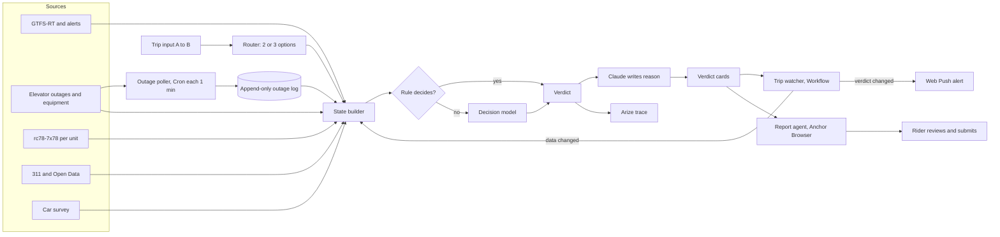
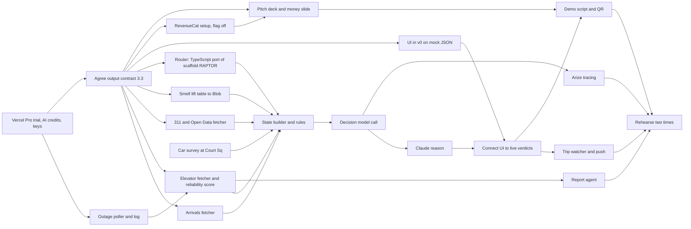

# Magic Carpet: engineering notes and requirements

2026-10-19 · RevenueCat × Pursuit build night

Product, users and rationale: [Magic Carpet.md](Magic%20Carpet.md). This doc specifies the build.

## 1. Scope tonight

We build Magic Carpet Phase 1 (official feeds only) plus a decision layer.

In scope:

- A-to-B subway routing with 2 or 3 options.
- Verdicts: board or wait, step-free now, elevator working at arrival, elevator reliability 1 to 5, which car (surveyed stations only).
- Outage poller with an append-only log. It starts first.
- Trip watcher with push alerts.
- Report agent. It stops before Submit.
- If time permits: smell score per line and hour (section 11).

Out of scope tonight: buses, LIRR, Metro-North, ferries; crowd ratings other than a 2-tap prompt; bathrooms, booths, gate readers; app store release; paywall in the demo.

## 2. Corrections to Magic Carpet.md

Live checks on 2026-10-19 found these differences.

| Magic Carpet.md says | Live check | Effect |
| --- | --- | --- |
| Elevator availability history is systemwide only (`rc78-7x78`) | `rc78-7x78` is monthly per unit: `equipment_code`, outages, entrapments, AM peak, PM peak and 24 h availability. 694 units in Aug 2026 | Per-unit monthly reliability exists from day one. The poller adds event history: each outage start, end and hour |
| Elevator feeds need a free api.mta.info account | `nyct_ene.json` returns HTTP 200 with no key | No signup |
| 126 of 472 stations accessible (27%) | 164 of 472 (35%) on 2026-10-16 ([RT&S](https://www.rtands.com/passenger/mta-reaches-164-accessible-stations-breaks-ground-on-bryant-park-project/)) | Update the number |
| Terms: warn if realtime lag exceeds 1 min | Our first draft used 2 min | Stale threshold is 60 s |

## 3. Decision model

A decision model reads evidence, answers defined questions, and gives a probability for each permitted answer ([Vercel](https://vercel.com/i/what-are-decision-models)). We keep exact checks in code and always include a "not enough data" answer.

| Layer | Function | Tool |
| --- | --- | --- |
| 1. Rules | Decides facts and clear cases | Code |
| 2. Decision model | Decides unclear cases, gives a probability | AI Gateway decision model |
| 3. Explanation | Writes one reason. Does not change the verdict | `anthropic/claude-sonnet-5.5` through AI Gateway |

The Magic Carpet scale rule maps to answer types: yes/no for facts (Boolean), 1 to 5 for qualities (Score), and Choice for "which option".

| Verdict | Type | Decided by | Evidence |
| --- | --- | --- | --- |
| Step-free now | Yes/no | Rule | Station ADA flag, live outages, elevator inventory |
| Board or wait | Choice: `board_now`, `wait_next`, `switch_line`, `not_enough_data` | Rule, then model | Arrivals and ride times to the destination, alerts, feed age, line reliability, time of day |
| Elevator working at arrival | Yes/no probability | Rule, then model | Live outage, planned outage, per-unit history, backup unit, weather |
| Elevator reliability | 1 to 5 | Rule (formula) | 90-day availability from `rc78-7x78` and the poller log |
| Which car | Car number of N | Lookup | Surveyed positions only. Else "no data for this station" |

### 3.1 Rules

Step-free mode runs first. It removes each option with an elevator out on its path. Then the rules rank the remaining options. Rows apply in order. The first match wins.

Board or wait. Arrival time = wait + ride time + transfer walk. The live feed gives the ride time to the destination stop.

| Condition | Verdict |
| --- | --- |
| A feed is more than 60 s old | Show the MTA staleness warning. Send to the model, data marked stale |
| One option arrives 3+ min sooner | That option |
| Difference less than 3 min, or an active alert on a line | Decision model |
| No live data for one option | Not enough data |

Elevator working at arrival.

| Condition | Verdict |
| --- | --- |
| Active outage in the feed | No. Show the return time, next accessible station north and south, and the MTA alternative route text |
| Outage reason "Under Investigation" | No. Return time unknown (the feed shows a false 4:00 AM) |
| Planned outage covers the arrival time | No |
| No outage now | Decision model gives the probability |
| Unit not in the equipment list | Not enough data |

Elevator reliability (proposed anchors; Magic Carpet sets the ends):

| Score | 90-day availability |
| --- | --- |
| 5 | 99% or more |
| 4 | 97% to 99% |
| 3 | 93% to 97% |
| 2 | 75% to 93% |
| 1 | Less than 75%: do not plan around it |

The 2025 system average was 97.6%.

### 3.2 Decision model settings

- If the top answer is less than 0.6, show "not enough data". Tune 0.6 on logged trips.
- On a timeout or a bad response, show "not enough data". Do not guess.
- Decision fallbacks (AI Gateway) can rerun an uncertain decision on a second model. Each fallback bills a second call.

### 3.3 Output contract

All parts use this format. Agree on it first. Then the tracks in section 9 work in parallel.

```json
{
  "verdict": "board_or_wait",
  "answer": "board_now",
  "probability": 0.78,
  "decided_by": "decision_model",
  "reason": "The 7X reaches Flushing 4 minutes before the next local.",
  "reasons": ["Next 7X is 9 min out", "No alerts on the 7"],
  "official": { "next_7X_min": 2, "next_7_min": 5 },
  "sources": [
    { "name": "MTA GTFS-RT nyct/gtfs", "kind": "official", "as_of": "2026-10-19T20:04:10-04:00" },
    { "name": "Line reliability", "kind": "derived", "as_of": "2026-08-01" }
  ],
  "trace_id": "..."
}
```

- `decided_by`: `rule`, `decision_model`, `lookup` or `not_enough_data`.
- `sources[].kind` uses the Magic Carpet provenance terms: `official`, `derived`, `crowd`, `survey`.
- `official` holds MTA values unchanged. The MTA terms forbid changes, so the UI shows them next to the verdict.

### 3.4 Implementation

- Pin `ai@7.0.145`. `experimental_decide` is experimental.
- Decision model IDs: `openai/gpt-6-luna-decisions`, `microsoft/microsoft-decision-1`, `liquid/d1`. Test on 10 trips. Select one. None is on the free tier. `convaiinnovations/laya` is free, for local tests.
- Claude: `anthropic/claude-sonnet-5.5` (dot). Keep default `temperature` and `top_p`. A third-party guide reports HTTP 400 on other values.
- Claude does only layer 3, because the AI SDK Anthropic adapter drops probabilities.
- Arize: `@vercel/otel` plus `@arizeai/openinference-vercel`, export to `otlp.arize.com/v1/traces`. Set `experimental_decision: true` in telemetry. Each trace holds the state, the verdict and later the result. This is the labeled set.

## 4. Data sources

### 4.1 MTA

No MTA source below needs a key. Feed URLs start with `https://api-endpoint.mta.info/Dataservice/mtagtfsfeeds/`.

| Source | URL or ID | Freshness | Use |
| --- | --- | --- | --- |
| Subway GTFS-RT, 8 feeds | `nyct%2Fgtfs` plus `-ace`, `-bdfm`, `-g`, `-jz`, `-nqrw`, `-l`, `-si` | 7 to 15 s | Predicted arrival per stop and direction. Express IDs `7X`, `6X` |
| Service alerts | `camsys%2Fsubway-alerts.json` | About 100 s | Skipped stops, reroutes, delays |
| Elevator outages | `nyct%2Fnyct_ene.json` | Less than 30 min | Current and planned outages per unit |
| Elevator equipment | `nyct%2Fnyct_ene_equipments.json` | Live | 707 units: stop ID, backup unit, next accessible station north and south, alternative route text |
| Subway timetable | `gtfs_supplemented.zip` | Daily | Router input |
| Stations | `39hk-dx4f` | Daily | ADA flag 0, 1, 2 (2 = partial) |
| Elevator inventory | `94fv-bak7` | Daily | Platform each unit serves. Coordinate columns are swapped |
| Elevator availability | `rc78-7x78` | Monthly per unit, to 2026-08 | Reliability score, model evidence |
| Entrances and exits | `i9wp-a4ja` | 2024 snapshot | 102 elevator entrances |
| Wait assessment | `s666-h6b7` | Monthly, to 2026-08 | Line reliability |
| Customer journey metrics | `r7qk-6tcy` | Monthly, to 2026-08 | Extra platform and train minutes per line |
| Hourly ridership | `5wq4-mkjj` | About 11 days behind | Station crowding by hour |

Build rules from the live tests:

- The 7 is in `nyct%2Fgtfs`. `gtfs-7` returns HTTP 200 with an error body. Check the content type.
- Do not send HEAD requests. They get HTTP 403.
- `nyct_ene.json` mixes current and planned outages. Keep only current rows for "now".
- Outage dates are text in New York time: `MM/DD/YYYY hh:mm:ss PM`.
- Elevator stop IDs are per station complex (for example `719/F09/G22`), not per platform. Use `94fv-bak7` or the description text to find the platform.
- Most alerts are planned future work. Filter by the active time window.
- Live predictions have no confidence and no crowding. Line history supplies the spread.
- Court Sq-23 St (F09) has E and F service. The M does not stop there now.
- Join all data on the GTFS stop ID.

### 4.2 Which car

- No open dataset maps cars to exits or elevators. The GTFS has no `pathways.txt` or `levels.txt`.
- Show only surveyed positions. Show "no data for this station" elsewhere. Geometry estimates are 70 to 80% correct at simple stations and unreliable at complex ones, so we use them only to pre-fill the survey form.
- Survey the elevator car first, then transfers, then exits. Start with Court Sq (426 m from Pursuit HQ).
- Train length: A Division (numbered lines) 510 ft, B Division (lettered lines) 600 ft. The G is about 300 ft on a 704 ft platform.
- Data model: the "Which car to target" table in Magic Carpet.md.

### 4.3 311 (`erm2-nwe9`)

- Data is 1.5 to 2 days behind. Use it for history only.
- Use only physical-condition types near entrances: Street Light Out, Pedestrian Signal, APS, sidewalk blocked by construction, Pedestrian Ramp Defective, Catch Basin Clogged, Flooding on Street.
- 311 has no odor or cleanliness types for the subway. Subway records start in 2020.
- Do not use person-based types (Panhandling, Homeless Person Assistance, Encampment). They act as a safety score. See "The safety-rating trap" in Magic Carpet.md.
- Subway records have `location_type` "Subway" or "Subway Station". `bridge_highway_name` holds the line, `road_ramp` the station or entrance, `bridge_highway_segment` the area (Mezzanine, Platform, Entrance, Stairway, Passageway).
- The 311 "Elevator" type covers private buildings only.

### 4.4 Other NYC Open Data and public APIs

| Source | Freshness | Use | Tonight |
| --- | --- | --- | --- |
| NWS `api.weather.gov` (send a User-Agent header) | Hourly forecast | Rain or heat in the elevator evidence and the wait | Yes |
| Permitted events `tvpp-9vvx` | Daily | Crowding near a station. Text location only | Yes |
| DOT street closures `i6b5-j7bu`, `478a-yykk` | Daily | Blocked walk to an entrance | Yes |
| Accessible Pedestrian Signals `de3m-c5p4` | Sep 2026 | Accessible crossings near an entrance | Yes |
| Pedestrian ramps `ufzp-rrqu` | 2021 survey | Step-free walk to the entrance | Partly |
| FloodNet `aq7i-eu5q` | Event history | "Floods in hard rain?" verdict | Later |
| Citi Bike GBFS | 60 s | Fallback when the wait is long | Later |
| NYC Ferry GTFS-RT | 20 s | Fallback on the East River | Later |

### 4.5 Report targets

| Report | Where | Required fields |
| --- | --- | --- |
| Subway elevator or escalator outage | [MTA form](https://contact.mta.info/s/forms/elevator-escalator-outage) | Date, time, station, equipment ID (EL### or ES###) |
| Street or sidewalk problem near an entrance | [311 portal](https://portal.311.nyc.gov/report-problems/) | Type, location, description |

The 311 API is read-only. Report creation needs the Developer Partner tier and admin approval. For this reason, a browser agent fills each form and stops before Submit.

## 5. Architecture



### 5.1 Vercel products

The team needs Vercel Pro. Hobby forbids payments and limits Cron to once a day. Start the 14-day Pro trial ($20 credit) on one team.

| Need | Product | Package or API | Limit that matters |
| --- | --- | --- | --- |
| Mobile web app, installable | Next.js PWA | `app/manifest.ts` | Static-first: pre-render station pages |
| UI first draft | v0 | v0.app | Hobby: 7 messages/day |
| Fetchers, router, decider | Vercel Functions, Fluid compute | `maxDuration` | Pro: 800 s, 4 GB |
| Outage poller | Cron Jobs | `vercel.json` `crons` | Pro: once each minute |
| Outage log | Postgres from Vercel Marketplace (Neon) | SQL, insert only | Append-only table |
| Daily timetable | Cron writes to Vercel Blob | `@vercel/blob` `put()` | Hobby 1 GB |
| Live feed cache (15 to 30 s) | Runtime Cache | `getCache()` from `@vercel/functions` | 2 MB per item. Largest subway feed is 198 KB, alerts 922 KB |
| Trip watcher | Vercel Workflows | `workflow`: `"use workflow"`, `"use step"`, `sleep('30s')` | About 600 events per 60 min trip. Hobby 50K events/month |
| Decision model, reason | AI Gateway | `AI_GATEWAY_API_KEY` or `VERCEL_OIDC_TOKEN` | Buy credits. Set a budget |
| Thresholds, `paywall_enabled` | Vercel Flags | `flags`, `@flags-sdk/vercel` | Number and JSON values |
| Tracing | AI SDK telemetry, Vercel Observability | `@vercel/otel` | Arize as in 3.4 |
| Demo URL protection | BotID | `botid`: `initBotId`, `checkBotId()` | Basic only on Hobby |
| Analytics | Web Analytics | `@vercel/analytics` | Custom events need Pro |

Not Vercel:

- Push: `web-push` with VAPID keys. iPhone needs iOS 16.4+ and "Add to Home Screen". Test each demo phone early. Chat SDK (Telegram or Slack) is the fallback.
- Report agent browser: Anchor Browser, for its live view. Vercel Sandbox runs headless Chromium, but a live view needs a noVNC build.
- Do not use AI Elements. Vercel removes it at the end of Nov 2026.
- Edge Config is now Global Config. We use Vercel Flags.

### 5.2 Router

The router is a TypeScript port of the router in `~/Projects/apps/iOS/scaffold` (Swift, our own project). We write new code tonight and copy the design. This obeys the "new code on the night" rule. Tell the judges the source.

| Item | Scaffold source | Port |
| --- | --- | --- |
| Search | McRAPTOR, `Sources/TransitGTFS/TransitRouter.swift:89`, max 5 rides | RAPTOR, max 3 rides |
| Ranking | `Sources/TripPlanner/PlanSelection.swift:7`: keep fastest and cheapest | Same, `maxPlans` 3, no shelter weight |
| Timetable | `gtfs_supplemented.zip` (19.7 MB), compiled on the phone in 4.7 s | Cron compiles it to Blob. The function loads it once per instance |
| Live data | 8 subway GTFS-RT feeds plus alerts. 30 s cache, 3 s timeout, trips within 2 h | Same values |
| Ride step | Line, direction, stops, path, delay, alerts. No train ID | Add `trip_id` and line. Board or wait needs them |
| Station access | Reads the ADA column, then drops it (`Sources/OpenDataStore/Records.swift:319`) | Keep it |
| Tests | G-line fixtures, `Tests/TransitGTFSTests/Fixtures/subway-g/` | Run the port on the same fixtures. Compare with `scaffold-cli` |

### 5.3 Agents

| Agent | Function | Stops |
| --- | --- | --- |
| Outage poller | Each minute, compares the outage feed to the last state. Inserts each change | Never |
| Decider | Runs rules, then the decision model | When it returns a verdict |
| Trip watcher | One Workflow run per trip. Runs the decider each 30 s. Pushes an alert on a change | When the rider arrives or cancels |
| Report agent | Fills the MTA or 311 form in Anchor Browser | Before Submit. The rider approves |

## 6. Requirements

### 6.1 Functional

| ID | Requirement | Tier | Tonight |
| --- | --- | --- | --- |
| FR1 | Trip entry by station or address, no account | Free | Must |
| FR2 | A-to-B routing: 2 or 3 subway route options | Free | Must |
| FR3 | Step-free now, per station on the trip | Free | Must |
| FR4 | Elevator working at arrival, per station on the trip | Free | Must |
| FR5 | Elevator reliability 1 to 5, per unit | Free | Must |
| FR6 | Board or wait with probability, reason, data age | Free | Must |
| FR7 | Which car at surveyed stations | Free | Must |
| FR8 | Tap a verdict to see its sources, sample size, age and confidence | Free | Must |
| FR9 | Outage poller and append-only log | n/a | Must, first |
| FR10 | Watch my trip: check and push an alert on change | Pro | Must |
| FR11 | Report agent, stops before Submit | Pro | Should |
| FR12 | 2-tap prompt after the trip: "Elevator working?" "Verdict correct?" | Free | Should |
| FR13 | RevenueCat paywall and restore purchase, off for the demo | Both | Later |
| FR14 | Saved commutes and warning before departure | Pro | Later |
| FR15 | Smell score: relative, per line, hour and month, plus crowd tap (section 11) | Free | Should |

### 6.2 Non-functional

| ID | Requirement |
| --- | --- |
| NFR1 | WCAG 2.2 AA. Screen reader test before the demo |
| NFR2 | Verdict in less than 3 s from tap |
| NFR3 | No signal: show the last verdict with its time, not a spinner |
| NFR4 | Live data more than 60 s old: show "data may not be current" (MTA terms) |
| NFR5 | Show MTA values unchanged next to our verdicts. Say the data comes from the MTA. Do not imply MTA endorsement |
| NFR6 | Keys only in environment variables |
| NFR7 | Before any subjective field ships: compare it with census data near each station. Cut the field if demographics predict it better than its physical cause |

### 6.3 Edge cases

| Case | App action |
| --- | --- |
| Train in the schedule but not in the live feed | Mark it "not confirmed" |
| Station has no elevator | Say so. Show the next accessible station north and south |
| Night or weekend service change | Read active alerts before rules run |
| Outage feed is down | Use the last poller state with its time |

## 7. RevenueCat

- One entitlement `pro`. One offering with a monthly and an annual package.
- Web SDK `@revenuecat/purchases-js`. Sandbox API key plus Stripe test mode.
- Payments need Vercel Pro.
- Demo: Vercel Flag `paywall_enabled` = `false`. All features are open. Only the money slide shows the tiers.

Proposed tiers (product owner to confirm):

- Free: all step-free, elevator, board-or-wait and which-car verdicts. Magic Carpet is accessibility-first. We do not charge for accessibility verdicts.
- Pro: watch my trip, saved commutes, warnings before departure, report agent.
- Price: $2.99/month or $19.99/year. Benchmarks: Citymapper Club $1.49 or $9.99, Subway Now+ $1.99 or $14.99, Transit Royale $4.99 or $24.99.
- Open: civic or commercial, and the MTA commercial license (Magic Carpet.md, "Three questions to answer before building").

## 8. Demo

1. Show a QR code. The audience enters two station names. The app needs no account and stores no location.
2. Run 3 trips on the big screen: board or wait, step-free with an elevator verdict, which car at Court Sq.
    - Board-or-wait script: Court Sq to Flushing on the 7. In the 20:04 test, the best choice changed from train to train. The 20:06 7X arrived 20:28. The 20:09 local arrived 20:32. The 20:13 7X arrived 20:34. If you miss the express, board the local.
3. Start "Watch my trip" on a team phone. Show a live alert, or replay a logged alert.
4. Show the Arize trace for one verdict.
5. Show the report agent fill the MTA form in the Anchor live view. It stops before Submit.
6. Show the outage log growing since the start of the night.
7. End on the money slide.

Only team members supply personal data on stage.

## 9. Build plan

The output contract (3.3) is the shared dependency. Start the poller first: its history cannot be recovered later.



| Track | Owner | Starts after |
| --- | --- | --- |
| Setup and outage poller | Builder 1 | Now |
| Car survey at Court Sq | Product owner | Now |
| Data fetchers (3 in parallel) | Builders 1 and 2 | Contract |
| Router port | Builder 3 | Contract |
| Decision layer | Builder 1 | Fetchers, router |
| UI | Builder 3 | Contract |
| Agents | Builder 2 | Live verdicts in UI |
| RevenueCat setup (flag off) | Builder 3 | Contract. Not on the critical path |
| Pitch, demo script, tests | Product owner | Contract |

### 9.1 Setup

```sh
npm install -g vercel
vercel login
vercel link
vercel env pull .env.local
npm install ai@7.0.145
```

`vercel env pull` writes the keys (for example `AI_GATEWAY_API_KEY`) to `.env.local`. Do not commit `.env.local`.

## 10. Engineering risks

Product and business risks: Magic Carpet.md, "Risks and open decisions".

| Risk | Effect | Mitigation |
| --- | --- | --- |
| `experimental_decide` changes or fails | No model verdicts | Pin `ai@7.0.145`. Rules still give verdicts. Model failure gives "not enough data" |
| No AI Gateway credits | No model or reason | Buy credits early. Set a budget |
| Router port takes too long | No A-to-B routing at the demo | Use fixed route options for the demo trips |
| Router memory (267 MB peak in Swift) | Function crash or slow start | Subway feed only. Precompile in Cron. Test early |
| iPhone push needs Add to Home Screen | No alert on stage | Set up demo phones first. Chat SDK fallback |
| Elevator units map to station complexes | Wrong elevator at transfer stations | Use `94fv-bak7` and the description text |
| Venue Wi-Fi fails | Live demo fails | Record a backup run. Use a phone hotspot |
| Scaffold README: MTA terms on direct GTFS download | Compliance | Serve data from our servers (MTA terms). Read the terms before launch |

## 11. Smell score

MTA customer feedback gives a smell prior per line, hour and month. 311 cannot. No source gives a specific car. Magic Carpet rates smell 1 to 5 from crowd reports. The prior fills the gap before reports exist and has the label `derived`.

Source: `nh7m-at3e`, 2018-01 to 2026-09-26, about 3 weeks behind.

- Fields: `created_at` (UTC), `location_category` ("On a train" or "In a station"), `location_name`, `line_route_branch`, `subcategory`.
- Signal: subcategories "Smoke or Odor" and "Biowaste" (Biowaste starts in 2024). 7,542 reports since 2024, 2,784 on a train.
- Station name is blank in 59% of on-train reports.

Patterns:

- On-train reports peak in winter: Jan 347, Feb 321, Dec 329 vs. Jun 164, Oct 151. Correlation with the daily high: r = -0.36. Station reports rise slightly in heat: r = +0.11.
- The hourly pattern follows ridership. Divide by ridership share (`5wq4-mkjj`).
- Highest rate per 1,000 feedback cases: L 60.8, G 57.8, F 56.9, C 56.6, R 55.8.
- End-of-line stations show no extra odor reports.

Score. Show it as relative ("2x typical for the F at this hour"), not as a percent. We do not know the reports per ride.

```
lift_line  = (smell_L / cases_L) / (smell_all / cases_all)
lift_month = on-train share(month) / mean share
lift_hour  = smell share(hour) / ridership share(hour)
prior      = lift_line × lift_month × lift_hour, smoothed toward 1 for thin cells
```

Crowd loop:

- One tap after boarding: "smells", "fine", car number from the front.
- Reports on the same `trip_id` and car raise the score for the next rider. Each report fades in about 15 min (a guess to tune).
- Reports clear when the train reaches the end of the line.

Exclusions:

- Do not use "Laying across seats" or the 311 person-based types.
- The winter peak can link to people who shelter on trains. Rate the car condition, never people. Run the NFR7 check before the score ships.

Tonight: precompute the lift table offline to Blob. Show one card (FR15).
