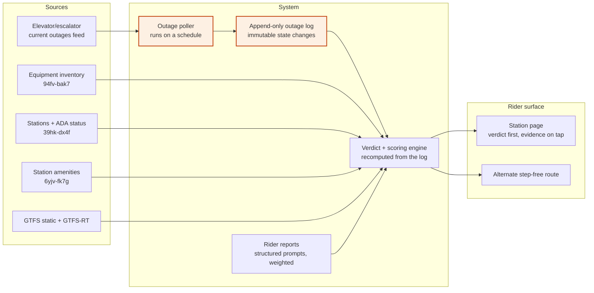

# A Judgment Layer for the NYC Subway

*Proposal ·* Oct 19, 2026 *·*&#32;

> A site that answers subway questions with verdicts — yes/no and 1–5 — instead of handing riders raw data to interpret on a platform with 40 seconds before the train comes.

## The decision riders actually make

A subway rider has seconds to decide, and needs a verdict — not a dataset to interpret while standing up, underground, with a train coming.

The questions repeat all day across the system:

- Can I get from street to platform without stairs, right now?
- The elevator shows "in service" — can I trust it to still be working when I come back at 6pm?
- Which end of the platform puts me at the exit I want?
- Is the bathroom here real or theoretical?
- Is it worth walking three blocks to a different station instead?

Every one has an answer. None is answered by what riders are handed today. The MTA publishes elevator outages as equipment IDs with outage reasons, schedules as GTFS feeds, and disruptions as prose alerts. All accurate, none of it a judgment. The rider still does the interpretation.

That interpretive work falls hardest on riders with the least slack — a parent with a stroller, someone using a wheelchair or walker, a rider with luggage, anyone for whom a broken elevator is not an inconvenience but a dead end. 166 of 496 subway stations are fully accessible, or 33%, with 8 more partially accessible, and the settlement that commits the MTA to 95% runs to [2055](https://www.amny.com/transit/mta-settles-lawsuits-agrees-to-make-95-of-subway-stations-accessible-by-2055). For the next thirty years, routing around the gaps is the rider's problem.

The MTA knows the system has a condition problem in the aggregate: its own Spring 2026 survey of 92,000 subway riders put satisfaction with station cleanliness at [60%](https://www.mta.info/article/mta-customers-count-spring-2026-survey-results). What it does not publish is which stations. A rider cannot act on 60%.

## What exists, and the gap it leaves

"We show elevator status" is not a product — the MTA shipped that in March 2026. The gap is everything downstream of status.

| Product | What it does well | What it leaves open |
| --- | --- | --- |
| [MTA app](https://www.governor.ny.gov/news/governor-hochul-announces-launch-new-best-class-mta-app-new-york-city-subway-and-bus-customers) (relaunched Mar 2026) | Accessibility Mode: map of accessible stations, live elevator/escalator status, screen reader support | Current status only, no reliability history; no condition ratings; no car guidance; cannot rate itself critically |
| [MTA Elevator & Escalator Status](https://mta.info/elevators) page | Authoritative live outage list with reasons and estimated return | Equipment-ID oriented; answers "is unit #243 down", not "can I make this trip" |
| Google Maps | Routing, transit crowding predictions | Per-car crowding coverage for NYC subway is [unconfirmed](https://timeout.com/newyork/news/google-maps-can-now-tell-you-how-crowded-subway-cars-are-101521); no elevator reliability, no station condition |
| [Exit Strategy NYC](https://apps.apple.com/app/id320946370) | Hand-mapped exit and transfer positions, down to the door, works offline | Static — no live data, no elevator status, no ratings; the car data is the product and it is not open |
| [elevatoruptime.com](https://www.elevatoruptime.com/about) | Ingests MTA feeds, tracks uptime | Non-commercial, dashboard-style; built for monitoring rather than trip decisions |

Three things nobody currently gives a rider:

1. **Event history, not monthly averages.** Per-unit history does exist, and an earlier draft of this document was wrong to say otherwise: [`rc78-7x78`](https://data.ny.gov/d/rc78-7x78) publishes outages, entrapments and peak availability per `equipment_code` every month back to Jan 2015 — 416 elevators in its latest month, Aug 2026. What nobody publishes is the **event record underneath**: when each outage began and ended, how long it ran, which hours of the day it hit, and anything fresher than a monthly release running about seven weeks behind. So the agency can tell you an elevator averaged 93% last August. It cannot tell you that this elevator fails most weekday evenings — which is what actually decides whether you route through that station.
2. **Condition, per station.** Cleanliness, smell, noise, bathroom reality. The MTA's own Passenger Environment Survey, which measured station conditions, stopped being published after 2019.
3. **Where to stand.** Car and door guidance exists only in one static paid app, built by hand over fifteen years, and covers exits rather than elevators or accessibility.

## The core bet: judgments are the product

A transit agency cannot publish an honest critical rating of itself, and that is a permanent structural opening.

The MTA will never ship a screen that says *this elevator fails 31% of the time, don't plan around it* or *this station scores 2/5 on cleanliness*. Not because of bad faith — because a public agency rating its own assets generates headlines, budget fights, and legal exposure. Its incentive is to report availability systemwide, which is why that is the only availability number it publishes. The same constraint binds Google: its transit data comes through agency partnership, and editorializing on agency quality is not a position it wants.

So the product is not a better data viewer. It is the opinion layer: taking public data plus rider reports and committing to a verdict.

Three consequences for the design:

- **Every answer is a verdict, not a reading.** Not "elevator ES241: ACTIVE OUTAGE, reason: maintenance" but **No — no step-free route to the uptown platform right now. Nearest step-free alternative: 14 St–6 Av, 4 min walk.**
- **Opinions must be defensible.** A verdict carries its evidence on tap: what it was computed from, how many reports, how recent, how confident. A rating nobody can interrogate is a rumor.
- **The reliability history is the moat.** Per-elevator *monthly* availability is published, so the starting point is better than it looks and a reliability score can ship on day one. What nobody publishes is the event record — outage starts, durations, time-of-day patterns — and the live outage feed can be polled and accumulated into exactly that. Six months of polling produces a dataset that cannot be bought, bought back, or scraped from anyone else — and it compounds, which is the only kind of advantage worth building on in a space where the incumbent has the official data.

## The rating system

One rule governs which scale a question gets: **yes/no for facts that are true or false at a moment, 1–5 for qualities reasonable people would score differently.**

Breaking that rule is how rating sites become useless. "3/5 — has an elevator" is meaningless. "Yes — clean" is a lie, because clean is a spectrum and the rider wants to know where on it. Getting the assignment right is most of the design work.

Provenance vocabulary used below: **Official** = straight from an MTA feed or dataset. **Derived** = computed by us from official data. **Crowd** = rider reports. **Survey** = our own field audit.

### Yes/no — the binaries

| Verdict the rider sees | Underlying question | Source |
| --- | --- | --- |
| Step-free right now? | Is there a working elevator path street → platform for my direction, at this moment? | Derived: ADA status + live outage feed |
| Step-free on a good day? | Does a step-free path exist at all when nothing is broken? | Official: station ADA field (0/1/2) |
| Can I switch direction without paying again? | Is there a crossover or crossunder inside fare control? | Survey + Crowd |
| Free transfer to my next line? | Is the transfer in-system, or out-and-back-in? | Official: GTFS transfers |
| Working bathroom? | Open, and functioning, within the last week | Official: `6yjv-fk7g` (a restroom exists here) + Crowd (open and working) |
| Agent in the booth? | Is there a human to ask or to open the gate? | Crowd |
| Tap reader at the wide gate? | Can a wheelchair user actually pay at the accessible gate? | Official: `6yjv-fk7g` (accessible fare-gate entrance present) + Survey (whether the reader is reachable from it) |
| Floods in hard rain? | Known water-intrusion station | Crowd + news archive |
| Platform gap worth minding? | Dangerous step or gap at this platform | Survey + Crowd |

The third and seventh rows matter more than they look. A missing crossover turns a one-stop mistake into a twenty-minute recovery, and it appears in no consumer product. A tap reader positioned away from the wide gate makes a nominally accessible station unusable — a complaint riders have [raised about OMNY](https://www.amny.com/transit/mta-touts-access-a-ride-service-gains-but-riders-remain-skeptical/) directly.

### 1–5 — the degrees

Every scale is anchored at both ends. An unanchored 1–5 drifts into noise, because a rider's "3" and ours must mean the same thing.

| Rating | 1 means | 5 means | Source |
| --- | --- | --- | --- |
| Elevator reliability | Out more than a quarter of the time — do not plan around it | Essentially always up over the last 90 days | Derived: our own accumulated outage history |
| Cleanliness | Visible trash, spills, standing liquid | Would not notice anything wrong | Crowd + Survey |
| Smell | Actively hard to stand in | No smell | Crowd |
| Noise | Cannot hear announcements or a phone call | Normal conversation is possible | Survey (decibel reading) + Crowd |
| Wayfinding | Got lost or missed a transfer | Signage made it obvious | Crowd |
| Crowding, by hour | Cannot board the first train | Seat available | Derived: GTFS headways + Crowd |
| Effort if not step-free | Long stair climbs, no escalator, no alternative | One short flight | Survey |

**Elevator reliability is the field that justifies the whole product.** It is the one number here that nobody else can produce today, it is the number that actually changes a trip decision, and it gets more accurate every day the poller runs.

*"Feels safe" is deliberately absent from both tables. That omission is a design decision, not an oversight — see the section on the safety-rating trap below.*

## Which car to target

Car guidance is the highest-value and most expensive feature here, because the data does not exist in any public feed and has to be built.

"Which car" is really four different questions, and they often disagree:

1. **Which car for my exit?** Puts me at the stairs I want at the far end.
2. **Which car for my transfer?** Puts me at the passageway instead of walking the length of the platform.
3. **Which car for the elevator?** The one that matters most, and the one nobody answers. An accessible station with the elevator at the south end is useless to a wheelchair user who boards at the north end and cannot cross the platform in time.
4. **Which car to avoid?** The empty car on a crowded train is empty for a reason — a broken A/C, or a situation. Local knowledge, and exactly the kind of thing a rating site should encode.

The output a rider wants is one line: **Board car 3 of 10 — puts you at the elevator at 59 St. Avoid car 1 (conductor's car, crowds at rush hour).**

### Why this part is hard

No MTA feed publishes door or car alignment. [Exit Strategy](https://apps.apple.com/app/id320946370) built its equivalent by having two people physically map more than 200 stations, and its data is proprietary. The GTFS-Pathways extension (`pathways.txt`, `levels.txt`) is the right standard for representing this, but the MTA's published GTFS does not appear to include it.

So the data model has to be built and seeded by hand:

| Field | Example | How it gets filled |
| --- | --- | --- |
| Station + direction + line | 59 St–Columbus Circle, downtown, A | Official (GTFS stop IDs) |
| Train length in cars | 10 | Official (rolling stock by line) |
| Elevator car position | car 3 of 10 | Seeded from elevator lat/lon in `6yjv-fk7g`, then field survey and rider confirmation |
| Exit car positions | car 1 → NW corner; car 10 → SE corner | Field survey + crowd |
| Transfer car position | car 8 → 1 train passageway | Field survey + crowd |
| Cars to avoid | car 1 at rush | Crowd only |

Two constraints make this tractable rather than hopeless. First, car position only needs to be recorded once per station-direction — platforms do not move. Second, it does not need full coverage to be useful: the elevator-car position for the 166 accessible stations is a finite, high-value target that no one has published, and it is a far smaller job than mapping every exit in the system.

There is also a cheaper partial path worth taking before any survey. The amenities dataset carries **446 elevator records with individual lat/lon**. That is not car position, but it locates each elevator along its platform — which answers most of question 3 above, *which car for the elevator*, without sending anyone into the field. Survey is then left with the narrow job of mapping that position to a car number, rather than discovering the position in the first place.

The honest scoping consequence: **car guidance ships for accessible stations first, one corridor at a time, and the site says plainly where it has no data.** Pretending to full coverage with guessed positions would destroy the product's credibility faster than any other mistake available to it.

## Where the data comes from

About half the proposed fields can be filled from official sources on day one; the other half has to be built, and knowing which is which decides the build order.

### Available now

| Source | What it gives | Access |
| --- | --- | --- |
| [Elevator & Escalator Equipment feed](https://www.mta.info/developers/display-elevators-NYCT) | Every unit: ID, station, location in station, lines served, whether it is part of an ADA path, alternate route when down | Free account at api.mta.info |
| Elevator & Escalator Current Outages feed | Which units are down, why, estimated return; joins to equipment by ID | Same account |
| [MTA Subway Stations dataset](https://catalog.data.gov/dataset/mta-subway-stations) | All stations with GTFS stop IDs and ADA status (0 = not accessible, 1 = full, 2 = partial, plus direction notes) | data.ny.gov, open |
| [Subway Station Amenities](https://data.ny.gov/d/6yjv-fk7g) | Monthly snapshots, per station: restrooms, elevators, help points, accessible fare-gate entrances. **Existence, not working status** | data.ny.gov, open |
| [Subway GTFS static + GTFS-RT](https://www.mta.info/developers) | Stops, routes, transfers, headways, live arrivals | Open; realtime via api.mta.info |
| [Elevator/escalator availability, 2015–](https://catalog.data.gov/dataset/mta-nyct-subway-elevator-and-escalator-availability-beginning-2015) | Monthly availability **per unit** (`equipment_code`): outages, entrapments, AM/PM peak and 24 h availability, Jan 2015 → Aug 2026 | data.ny.gov, open |
| [MTA Pulse Survey, 2025–](https://catalog.data.gov/dataset/mta-pulse-survey-beginning-2025) | Satisfaction scores by mode and question | data.ny.gov, open |

### Not available — must be built

- **Event-level outage history.** Per-unit *monthly* availability is published (`rc78-7x78`, back to 2015), so reliability scores have a real baseline from day one. What is missing is the record underneath: each outage's start, end, duration and hour, and anything fresher than a monthly release about seven weeks behind. That is the gap the product fills, by polling the outages feed on a schedule and recording every state change. Cheap to run, impossible to backfill — which is the argument for starting the poller before anything else.
- **Car and door positions.** No feed. Field survey plus crowd confirmation.
- **Station condition.** The Passenger Environment Survey stopped after 2019. Crowd plus our own audits.
- **Whether a bathroom is open and working; booth staffing; gate-reader placement.** Note what changed here: `6yjv-fk7g` now publishes that a restroom, help point or accessible fare-gate entrance **exists**, which removes months of field survey from the plan. What it does not publish is whether any of them is open, working, staffed, or reachable from the wide gate. That half stays crowd and survey.

### License terms worth knowing before building

The MTA's [developer terms](https://www.mta.info/developers/terms-and-conditions) are permissive but carry real constraints:

- Data must be served from our own servers, not proxied from the MTA's.
- Data may be subsetted but **not modified or deleted** — so our ratings must sit visibly alongside official values, not overwrite them.
- If realtime lag exceeds one minute, the site must tell users the data may not be current.
- We may say the data came from the MTA; we may not imply MTA endorsement or licensing.
- We may not state or imply the data is accurate, complete or timely.
- The MTA can suspend the feed or change terms at any time, without notice.
- Commercial use depends on separate MTA licensing requirements that the terms page links but does not spell out.

That last pair is the material business risk: **the core feed can be withdrawn at the MTA's discretion, and whether a paid product needs a license is unresolved.** Both need an answer before anyone commits money. The accumulated outage history is partial insurance — it is ours, and it keeps its value even if the live feed goes away.

## Earning trust

A rating site dies of three causes — sparse data shown as confident, stale data shown as current, and gamed data shown as consensus. Each needs a mechanism, not good intentions.

**Sparse coverage.** With 496 stations and few early users, most stations will have zero or two reports. The temptation is to show an average anyway; two reports averaged to "2.5/5" reads identically to two hundred.

- Below a minimum sample, show **"not rated yet"** rather than a number. No exceptions, including for stations we care about.
- Display a confidence indicator beside every 1–5 value, driven by sample size and recency.
- Seed from official data wherever it exists so the map is never empty: ADA status and live elevator state alone make a useful site at launch with zero rider reports.

**Staleness.** A cleanliness rating from fourteen months ago is not information about today. A bathroom marked working in 2025 is actively misleading.

- Half-life decay on all subjective ratings, with the rate set per field: cleanliness and smell decay in weeks, platform gaps and crossovers effectively never — physical layout does not change.
- Every rating carries a visible as-of date.
- Fields with short half-lives get re-prompted first.

**Gaming and selection bias.** People report when angry, which skews everything downward, and any public rating attracts brigading.

- Collect through **structured prompts at the moment of truth**, not free-form reviews. A rider who just scanned a station gets asked two tappable questions — *Elevator working? Bathroom open?* — rather than a blank comment box. Structured prompts cut the anger premium, take three seconds, and produce comparable data.
- Weight by contributor history; discount new accounts and outliers.
- Verify what can be verified: a report that an elevator is down is checkable against the official feed within minutes, and contributors whose reports contradict the feed get down-weighted automatically.
- No free-text on station pages at launch. Text invites moderation load and abuse while adding little to a verdict.

**Provenance on every number.** Each verdict is tappable and shows what produced it: which feed, how many reports, how old, how confident. This is also a license requirement — the MTA's terms forbid implying the data is accurate or complete, and forbid modifying it, so official values and our judgments must stay visibly distinct.

The discipline that holds all of this together: **the site is allowed to say "we don't know."** A product whose whole value is being trusted at a decision point can survive gaps far better than it can survive one confident wrong answer that leaves a wheelchair user stranded on a platform.

## The safety-rating trap

A crowdsourced "feels safe" score for NYC stations would track the racial composition of surrounding neighborhoods more closely than it tracks anything that happens to riders. This is the single thing most likely to turn a useful product into a liability, and it has to be designed out from the start rather than patched later.

The precedent is specific. [SketchFactor](https://www.nbcnews.com/news/amp/ncna178136) launched in New York in 2014 letting users rate how "sketchy" a location felt. It was widely covered as an app for avoiding Black neighborhoods, and the criticism held up on the merits: riders of different races and class backgrounds interpret "dangerous" differently, the reports were unverified, and the moderation policy left room for the rest. The intent of the founders was not the problem. The field was the problem.

A subway rating site inherits that exposure in full, with an additional twist — safety ratings feed directly into routing, so a biased score does not just sit on a page, it sends riders around whole neighborhoods.

**The design response:**

1. **No general safety or "sketchiness" rating.** Not as a 1–5, not as a yes/no. The field is cut.
2. **Replace feelings with physical conditions**, which are observable, verifiable, and fixable — and which are what riders actually act on:

| Instead of | Ask | Why it holds up |
| --- | --- | --- |
| "Feels safe: 2/5" | Lighting: 1–5 | Observable, photographable, comparable between stations |
| "Sketchy at night" | Sightlines — can you see the length of the platform? | A physical property of the station |
| "Dangerous" | Is the platform staffed or is there a working help point? | A yes/no fact — help-point presence is official in `6yjv-fk7g` |
| "Avoid after dark" | How long is the wait at this hour? | From GTFS, no judgment needed |

3. **Never aggregate to a neighborhood or line verdict.** Ratings attach to stations and to specific conditions. A "worst stations" leaderboard is a headline generator and should not exist.
4. **Audit the outputs, not the intentions.** Before launch, correlate every subjective field against census demographics of the surrounding area. Any field that correlates more strongly with neighborhood demographics than with its own physical referent gets cut or restructured. Repeat quarterly. SketchFactor's failure was not that it lacked good intentions — it was that nobody tested the output.

There is a real cost here: riders do want to know about safety, and "we don't do that field" will read as a product gap to some users. That is the right trade. Lighting, sightlines, staffing and wait times cover most of what a rider genuinely needs, without building an instrument for redlining.

## Scope and phasing

```mermaid
flowchart LR
    P1["Phase 1 · Official data only<br/>Live step-free verdicts, accessible-station map,<br/>alternate route when an elevator is down<br/>Zero contributors required"]
    G1{{"Gate 1<br/>WCAG 2.2 AA, screen-reader tested<br/>Demographic correlation audit clean"}}
    P2["Phase 2 · Crowd ratings<br/>Structured prompts at the moment of truth<br/>Confidence indicators, half-life decay"]
    G2{{"Gate 2<br/>Corridor ratings have survived<br/>contact with actual riders"}}
    P3["Phase 3 · Car guidance<br/>Corridor-first, accessible stations first<br/>Elevator-car position, seeded then surveyed"]
    G3{{"Gate 3<br/>Coverage stated honestly where it is thin<br/>No guessed positions"}}
    P4["Phase 4 · Expansion<br/>Further corridors; reliability history compounds"]
    P1 --> G1 --> P2 --> G2 --> P3 --> G3 --> P4
    classDef gate fill:#fff4e5,stroke:#d97706,stroke-width:1px;
    class G1,G2,G3 gate;
```

Phase 1 is the one worth dwelling on: a site built only on the official feeds — live step-free verdicts, accessible-station map, alternate routes when an elevator is down — is already more useful than what riders have, and it needs no contributors at all. That removes the cold-start dependency entirely. Crowd ratings and car guidance then arrive as upside on a product that already works, instead of being the thing a launch is gambling on.

Each gate is a real stop, not a checkpoint to wave through. Phase 1 does not ship until the site passes WCAG 2.2 AA with real screen-reader testing and the demographic correlation audit comes back clean. Phase 3 does not start until the corridor's ratings have survived contact with actual riders.

## Architecture

The two accented boxes are the whole technical argument. Everything else here is ordinary web engineering that any competent team can do in a quarter; the poller and the append-only history are what make the product hard to copy a year from now.

**Deliberate choices worth noting:**

- **Append-only history, never overwritten.** Outage records are immutable state changes, not a current-status table. Reliability scores are recomputed from the log, so the scoring formula can change later without losing the data — and it will change.
- **Join everything on GTFS stop ID.** The MTA's own datasets key on it, which keeps the elevator feed, stations data, schedules and our ratings in one namespace instead of a reconciliation problem.
- **The site must be static-first and work on a bad platform connection.** Most of this content is read underground on a weak signal. Pre-render station pages, cache aggressively, and degrade to last-known state with a visible timestamp rather than a spinner.
- **Accessibility is a build constraint, not a feature.** WCAG 2.2 AA, tested with screen readers by people who use them daily. A site about subway accessibility that is itself inaccessible has no claim on anyone's attention — and the MTA's developer terms separately require compliance with applicable accessibility law.
- **No app at launch.** A fast mobile web page is reachable from a link, needs no install before a trip someone is already late for, and halves the build. Report prompts work fine in a browser.

## Risks and open decisions

| Risk | Severity | Response |
| --- | --- | --- |
| MTA withdraws the feed or changes terms without notice | High — explicitly reserved in the terms | Accumulated history stays ours and keeps value; degrade to last-known state with honest timestamps |
| Commercial use needs an MTA license | High — unresolved | Resolve before monetizing; a civic/nonprofit posture may sidestep it entirely |
| A rider relies on "step-free: yes" and gets stranded | High — real harm to the people this is for | Never assert without a timestamp; always show the fallback route; show confidence; make "unknown" a first-class answer |
| MTA ships reliability history itself | Medium | They can publish neutral history; they cannot publish critical self-ratings. Judgments, car guidance and condition stay defensible |
| Cold start — no ratings, so no users, so no ratings | Medium | Launch useful at zero reports, on official data alone; crowd fields are upside, not the foundation |
| Field survey cost for car positions and lighting | Medium | Corridor-first; recruit from disability advocacy groups who have the motivation and the expertise |
| The site itself fails accessibility standards | High — fatal to credibility | WCAG 2.2 AA as a launch gate, screen-reader tested by actual screen-reader users; the MTA terms also require compliance with applicable accessibility law |

### Three questions to answer before building

1. **Who is the primary user?** Accessibility-first riders, or all commuters? These produce different products and the schema above cannot serve both equally. **Recommendation: accessibility-first.** The need is acute rather than nice-to-have, the value is unambiguous, the elevator-reliability moat points directly at it, there is an organized community to recruit from, and a product that works for a wheelchair user at 2am works for everyone else by construction. The reverse is not true.
2. **Civic or commercial?** This determines the MTA licensing exposure, whether field survey can be volunteer-staffed, and whether "we don't know" is an acceptable answer to investors. It should be settled before the first line of code, not after.
3. **Which corridor first?** Needs one line or one neighborhood with enough accessible stations to be useful, picked with input from riders rather than from a map.

### What to do first, regardless of those answers

**Start the outage poller this week.** It is perhaps a day of work, it costs almost nothing to run, and every day it is not running is a day of per-outage event history that cannot be recovered later. The monthly per-unit averages will still be there; the event record will not. That dataset is the product's only durable advantage, and it is the one thing here that gets strictly more valuable while the open questions are being argued about.
